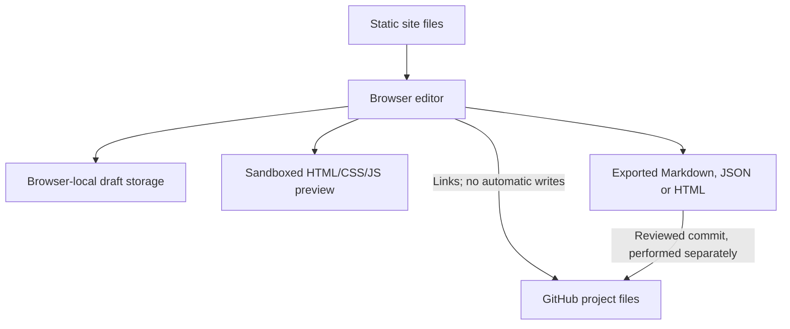
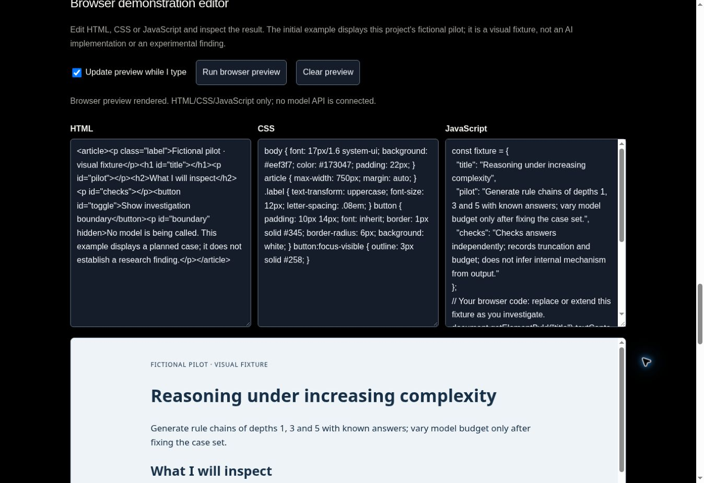

# Workbench architecture and use

This is the architecture of the working educational interface, not a recovered map of any model's internal computation. Each project needs its own system-specific diagram as its implementation is investigated.

The preview uses an iframe sandbox without same-origin access, plus a content security policy restricting API and resource requests. It is intended for trusted code you are learning from, not hostile code or unrestricted remote execution. Model APIs and installed applications are not connected. Local Python, server code, cloud deployment and GPUs are separate execution choices for a future project-specific implementation.

## Code to inspect

- [Workbench HTML](https://github.com/manifoldgrace/manifoldgrace.github.io/blob/main/research-project.html): the accessible interface and runtime explanation.
- [Annotated JavaScript module](https://github.com/manifoldgrace/manifoldgrace.github.io/blob/main/research-workbench.mjs): initial per-project drafts, type-checked imports, local storage, Markdown export, preview construction and UI events.
- [Workbench tests](https://github.com/manifoldgrace/manifoldgrace.github.io/blob/main/tests/research-workbench.test.mjs): 39-project round trips, draft isolation, invalid input handling and preview policy checks. These test the workbench, not scientific claims about AI.
- [Shared methodological guide](RESEARCH-GUIDE.md): scientific evaluation, engineering assurance, figures, attribution and research releases.

## From browser draft to durable contribution

1. Select a project and edit its dossier or demo. Changes remain in that browser.
2. Export JSON to resume editing on another device, Markdown for your report, or HTML for a self-contained browser demo.
3. Inspect imported demo code before choosing to run it; imports pause automatic execution.
4. Put reviewed writing and code in the corresponding project folder through a normal GitHub edit/commit. Preserve the original records and describe what changed.
5. Link supporting evidence and label the work's status. A commit records a version; it does not establish originality, correctness or peer review.

Framework prepared with AI assistance for Grace R. Nettey's review and development, 6 November 2026. No scientific runs, research release tags, DOI deposits or originator messages were made by this setup.

## Interface illustration

Preview screenshot, 6 November 2026. This illustrates the editor and a fictional pilot; it is not an experimental result or a model-capability demonstration.
