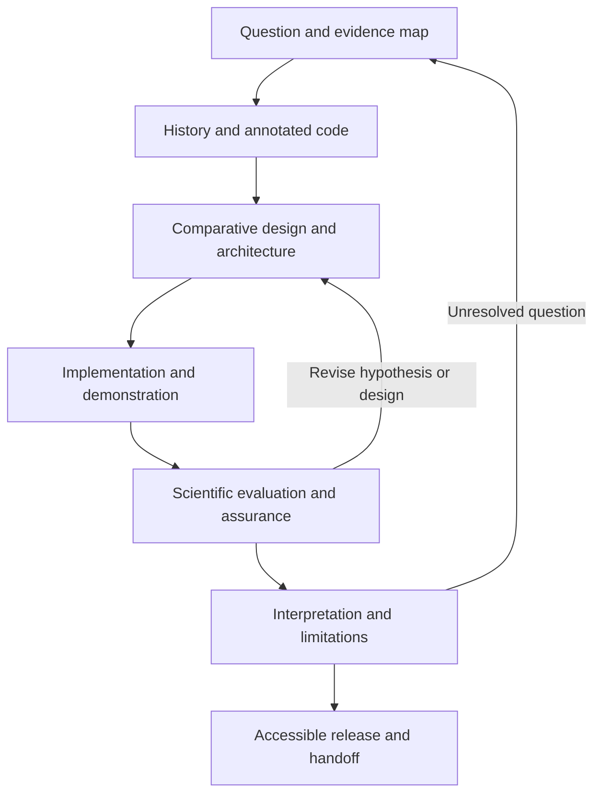

# Research dossier: Groq — Structured Outputs

Owner: Grace R. Nettey. Prepared with AI assistance 2026-11-06; editable working plan, not findings.

[Online dossier and demo](https://manifoldgrace.github.io/research-project.html?project=company-gap-17) · [Research entry](https://manifoldgrace.github.io/feature-contributions.html#company-gap-17) · [Shared methodological guide](../../RESEARCH-GUIDE.md) · [Code and pilot](README.md) · [Hand annotations](NOTES.md)

## 1. Research question, scope and contribution

Define the problem, unit of analysis, intended audience, terms, exclusions and success criteria. State whether the work is exploratory, replication, evaluation, extension or a combination. Record why the question matters and what would count against the proposed answer.

Working plan: investigate the documented question for Groq — Structured Outputs. Initial fictional pilot: List a small matrix of schema, streaming and tool flags for one selected model; initially leave every outcome untested.

Refine the research question, scope and success criteria before evaluation.

## 2. Historical development and primary evidence

Trace dated milestones through original papers, repositories, releases, design records and originator links. Distinguish first proposal, implementation, release and later interpretation. Attribute documented rationales; label your own reconstruction of why a choice was made as an inference and consider alternatives.

_Your analysis, evidence and decisions:_

| Date / version | Milestone | Primary source / originator link | Documented rationale or your inference | Limits |
| --- | --- | --- | --- | --- |
| To investigate | | | | |

## 3. Source-code inspection and annotated implementation

Record the exact revision, relevant files/functions, dependencies, licences and the path from input to output. Annotate what each important component does, its assumptions and limits. Separate upstream code, your changes, original code and AI assistance. Do not equate an SDK with the proprietary service it accesses.

Source starting point: https://github.com/groq/groq-python/tree/55066d94acca028c3cb74e050f2711b80ade6298/src
Revision: 55066d94acca028c3cb74e050f2711b80ade6298
Scope: Official API client; structured-output/tool/stream compatibility is server and model dependent.
Reuse terms: Apache-2.0

Code inspection and hand annotations remain to be completed.

## 4. Scientific framing and evaluation design

Define constructs, hypotheses or exploratory questions, operational measures and competing explanations. Specify case selection, controls, baselines, interventions, sampling, repetition/seeds where applicable, budgets and uncertainty. Address construct, internal, external and ecological validity. Separate pre-specified tests from post-hoc exploration and statistical significance from practical importance.

Initial observation checks to refine: Records exact supported combination; distinguishes rejection from semantic error; never invents test results.

Define the baseline, competing explanation, unaffected control, case set and uncertainty before treating these checks as an evaluation protocol.

## 5. Architecture, interfaces and execution environment

Draw components, data flows, protocols, trust boundaries, state, storage and dependencies. Distinguish observed architecture from proposed designs and unknown internals. Identify where computation runs: browser, local Python, remote API, cloud CPU/GPU or simulator. Discuss latency, memory, cost, access and failure recovery. Include Infrastructure as Code (IaC) or unified communications only where genuinely relevant.

_Your analysis, evidence and decisions:_

## 6. Comparative design and original contribution

Compare the upstream baseline with your replication, alternative or extension using matched conditions and explicit differences. Explain design choices and trade-offs. Candidate contribution may be a method, negative result, dataset, diagnostic, implementation, synthesis or collaboration; originality remains a claim to investigate through prior-art checking, not an automatic property of hand-written text.

_Your analysis, evidence and decisions:_

| Dimension | Upstream baseline | My alternative / extension | Evidence needed |
| --- | --- | --- | --- |
| Behaviour / method | To inspect | To design | Matched comparison |
| Architecture / resources | To document | To design | Measured or bounded evidence |
| Contribution / prior art | To establish | Candidate contribution | Prior-art search and attribution |

## 7. Implementation and reproducibility

Record environment/dependency versions, setup commands, fictional or authorised data, configuration, deterministic checks and model/API details. Preserve raw inputs/outputs and versioned transformations. Provide a small reproducible example; distinguish a visual demonstration, mock, offline test and live integration. Document changes and rollback/recovery steps.

_Your analysis, evidence and decisions:_

## 8. Observations, failures and uncertainty

Report observations and failures with denominators, configurations, exceptions, missing runs and relevant uncertainty. Link each claim to raw evidence and scoring rules. Separate observed behaviour from inferred mechanisms, anecdote from repeated findings and tool/harness errors from model failures. Include null and negative results; never invent a chart or completed run.

No research experiment results recorded in this dossier. Record raw observations separately from interpretation.

## 9. Ethical, societal and governance analysis

Consider affected groups, access, power, labour, cultural context, privacy, consent, distribution of benefits/harms and routes of challenge. Explain the ethical or sociotechnical framework used and its limitations. Assess the selected system/version at its evidenced lifecycle stage rather than assuming a universal AI maturity level. Separate normative recommendations from empirical findings.

_Your analysis, evidence and decisions:_

## 10. Quality assurance, security and the SDLC

Select proportionate checks across requirements, design, implementation, testing, integration, deployment and maintenance. Distinguish scientific evaluation from unit/integration/regression, adversarial, accessibility and user-acceptance testing. Record threat models, permissions, secrets, dependencies, data handling, human review, CI/CD gates and rollback. A check passed or framework referenced is not certification or a guarantee of safety.

_Your analysis, evidence and decisions:_

## 11. End-to-end plan, milestones and decisions

Map the route from question and literature/code inspection to design, implementation, evaluation, interpretation, review and handoff. For each milestone specify deliverable, acceptance evidence, dependencies, resource budget and next action. Revisit earlier stages when findings change the question. Mark actual versus planned completion explicitly.

_Your analysis, evidence and decisions:_

All milestones are planned, not completed. Edit [ROADMAP.mmd](ROADMAP.mmd) and [milestones.csv](milestones.csv).

## 12. Illustrations, architecture and educational explanation

Use architecture/sequence diagrams for relationships, charts for measured results and annotated screenshots for observed behaviour. Provide captions, legends, units, uncertainty, alt text, source/version and creation method. Keep conceptual illustrations separate from empirical evidence. Pinterest is a discovery lead: locate the original source and reuse permission before uploading an image; record attribution and AI generation where applicable.

_Your analysis, evidence and decisions:_

## 13. Interpretation, contribution and limitations

Answer the bounded research question at the strength supported by the evidence. Explain what the approach adds, changes or enables, where the baseline remains better and what remains unresolved. Relate conclusions to theories and terminology accurately. Separate demonstrated improvement, suggestive evidence, design proposal and future hypothesis; state limitations and a practical next investigation.

No scientific conclusion or demonstrated improvement is asserted at setup. Complete the evaluation before replacing this statement.

## 14. Accessible handoff, research release and dissemination

Prepare a versioned package of report, code, permitted data/fixtures, figures, environment/run instructions, licence/attribution, limitations, contribution record and change log. Record accessibility review, evidence checks and reproducibility status. Decide whether it is a working note, technical report, preprint, software release or dataset. A public release is not peer review. Link an exact commit/tag and, if actually deposited, a version-specific persistent identifier. Draft originator feedback separately; do not infer receipt, collaboration or endorsement from sending it.

_Your analysis, evidence and decisions:_

## Claim-to-evidence and change records

Use `evidence.csv` for traceable claims and `NOTES.md` for hand-written observations. Link raw logs and figures by exact version. Keep a dated record of your changes and AI/upstream assistance. An email or portal submission is an optional later action requiring its own accurate delivery/status record.
